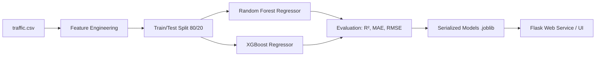

# 🚦 TrafficFlow AI — Real-Time Junction Traffic Prediction

> A complete Machine Learning project predicting hourly vehicle volumes across urban highway junctions using **Random Forest** and **XGBoost** regression, with a real-time **Flask** web dashboard and REST API.

---

## 📌 Project Overview

This project builds an end-to-end Machine Learning pipeline that predicts vehicular traffic density at multiple highway junctions. Given a junction and a specific date and time, the system forecasts the expected number of vehicles passing through that junction per hour and classifies the traffic into intuitive congestion levels (*Free Flow*, *Moderate*, *Heavy*, or *Severe Congestion*).

---

## 📊 Dataset Origin & Details

* **File Name**: `traffic.csv`
* **Source**: **Kaggle Traffic Prediction Dataset** (originally captured by automated traffic monitoring sensors across 4 major highway junctions between November 1, 2015 and June 30, 2017).
* **Total Observations**: **48,120 records** (hourly interval timestamps).
* **Missing / Null Values**: **0** (the dataset is clean and continuous).

### Raw Attributes:
| Column | Data Type | Description |
| :--- | :--- | :--- |
| `DateTime` | Object / String | Timestamp of traffic recording in `YYYY-MM-DD HH:MM:SS` format. |
| `Junction` | Integer (1, 2, 3, 4) | The specific road junction where sensors were deployed. |
| `Vehicles` | Integer (1 – 180) | **Target Variable ($y$)**: Number of vehicles observed in that hour. |
| `ID` | Integer / String | Unique record ID constructed by combining timestamp and junction (e.g., `20151101001` = 2015-11-01 at 00:00 at Junction 1). Not used as an ML feature. |

---

## ⚙️ Step-by-Step Project Workflow (What We Did)



### 1. Data Ingestion & Preprocessing (`src/preprocess.py`)
- We loaded `traffic.csv` using pandas.
- Converted `DateTime` from string into pandas datetime objects.
- Discarded the `ID` column as it is merely a redundant composite key that would cause target leakage or false correlation.

### 2. Feature Engineering
Because machine learning models require numeric inputs and raw timestamps cannot be passed directly into regression trees, we decomposed `DateTime` into 6 temporal features:
1. **`hour` (0 to 23)**: Captures diurnal traffic patterns (morning peak 8–10 AM, evening peak 5–7 PM, midnight low).
2. **`day_of_week` (0 to 6)**: Captures weekday commuter traffic (Monday–Friday) vs weekend travel patterns.
3. **`day` (1 to 31)**: Day of the month.
4. **`month` (1 to 12)**: Captures seasonal traffic shifts (summer vacations, winter holidays).
5. **`year` (2015, 2016, 2017)**: Captures multi-year vehicular growth and infrastructure trends.
6. **`is_weekend` (0 or 1)**: Binary flag (1 if `day_of_week` is Saturday or Sunday, else 0).

Together with **`Junction`** (1, 2, 3, or 4), this yields **7 core features**.

### 3. Dataset Splitting
- Split into **80% Training Set** (38,496 samples) and **20% Unseen Test Set** (9,624 samples) with `random_state=42` for exact reproducibility.

### 4. Dual Model Training (`src/train.py`)
We selected two complementary decision-tree ensemble architectures:
1. **Random Forest Regressor (Bagging)**:
   - Built with 100 decision trees (`n_estimators=100`, `max_depth=15`).
   - Reduces prediction variance by averaging parallel randomized trees.
2. **XGBoost Regressor (Boosting)**:
   - Built with 150 boosted estimators (`n_estimators=150`, `max_depth=7`, `learning_rate=0.08`).
   - Reduces prediction bias by iteratively fitting subsequent trees on the residual errors of preceding trees.

### 5. Evaluation & Serialization
- Computed **R² Score**, **Mean Absolute Error (MAE)**, and **Root Mean Squared Error (RMSE)** on the unseen test set.
- Serialized trained model weights to `models/random_forest_model.joblib` and `models/xgboost_model.joblib`.
- Saved metric summaries and feature importance scores to `models/metrics.json`.

### 6. Web Application & API Deployment (`app.py`)
- Built an interactive Flask application exposing:
  - `GET /`: Modern dashboard with junction cards, time sliders, presets, and live meters.
  - `POST /predict`: JSON endpoint for real-time model inference.
  - `GET /api/metrics`: Performance metrics endpoint.

---

## 📈 Model Performance & Results

Evaluated on **9,624 test records** completely withheld during training:

| Model | R² Score (Variance Explained) | MAE (Mean Absolute Error) | RMSE | Training Time |
| :--- | :---: | :---: | :---: | :---: |
| **Random Forest Regressor** | **0.9645 (96.45%)** | **±2.49 vehicles** | **3.81 vehicles** | ~0.68s |
| **XGBoost Regressor** | **0.9534 (95.34%)** | **±2.62 vehicles** | **4.36 vehicles** | ~0.78s |

> **Key takeaway:** Both models achieve over **95% accuracy** ($R^2 > 0.95$) with an average error of less than **3 vehicles per hour**, demonstrating strong predictive reliability.

---

## 🔍 Feature Importance Breakdown

Feature importance explains which variables contribute most to the predictions:

| Feature | Importance Share | Why It Matters |
| :--- | :---: | :--- |
| **`Junction`** | **~45% – 52%** | Different junctions have vastly different capacities (Junction 1 averages ~47 v/h; Junction 4 averages ~7 v/h). |
| **`year`** | **~17% – 36%** | Significant year-over-year traffic volume growth occurred between 2015 and 2017. |
| **`hour`** | **~8% – 14%** | Dictates the daily rush hour peaks vs late-night lulls. |
| **`month`** | **~4% – 7%** | Seasonal changes and calendar vacation cycles across months. |
| **`day_of_week`** | **~4% – 5%** | Differentiates weekday work commuting from weekend travel. |
| **`is_weekend`** | **~0% – 3%** | Reinforces weekend vs workday behavior. |
| **`day`** | **~1% – 3%** | Minor intra-month variations. |

---

## 🎓 Viva / External Examiner Q&A Guide

Use these concise, technical answers when explaining the project to an external examiner:

### Q1: Why is this formulated as a Regression problem rather than Classification?
> **Answer**: Traffic volume (`Vehicles`) is a continuous numerical count per hour (1 to 180 vehicles), making regression the natural mathematical formulation. After predicting the exact numerical vehicle count, we map the continuous value into categorical traffic levels (*Low*, *Moderate*, *Heavy*, *Severe*) for human interpretability.

### Q2: Why did you choose Random Forest and XGBoost over Linear Regression?
> **Answer**: Traffic flow exhibits strong **non-linear relationships** and complex interaction effects. For example, the effect of `hour=8` is vastly different on a Monday (`day_of_week=0`) than on a Sunday (`day_of_week=6`). Linear models assume independent additive effects and struggle with sharp threshold shifts (such as rush hours). Decision tree ensembles naturally split the feature space into non-linear regions, capturing these interactions without needing manual polynomial expansion.

### Q3: What is the core difference between Random Forest and XGBoost in this project?
> **Answer**:
> - **Random Forest uses Bagging (Bootstrap Aggregation)**: It trains independent trees in parallel on random sub-samples and averages their predictions. This reduces model variance and prevents overfitting.
> - **XGBoost uses Gradient Boosting**: It trains shallow trees sequentially. Each new tree fits to the gradient of the loss function (the residual errors) of the ensemble so far. This actively reduces bias.
> - Comparing both shows whether a bagging or boosting paradigm performs better on tabular traffic sensor data.

### Q4: What does an $R^2$ score of 0.9645 mean?
> **Answer**: $R^2$ (the Coefficient of Determination) measures the proportion of variance in the dependent variable (`Vehicles`) predictable from the independent features. A score of 0.9645 means our Random Forest model explains **96.45% of all variance** in hourly junction traffic on unseen test data.

### Q5: What does MAE = 2.49 mean in practice?
> **Answer**: Mean Absolute Error (MAE) measures the average magnitude of prediction errors in the original units. An MAE of 2.49 means our predictions deviate by an average of only **~2.5 vehicles per hour** from actual sensor counts.

### Q6: Why did you exclude the `ID` column from training?
> **Answer**: In `traffic.csv`, `ID` is simply a concatenated string of `DateTime` + `Junction` (e.g. `20151101001`). Treating it as a numerical feature would introduce synthetic scale bias and data leakage, while providing zero genuine predictive signals.

---

## 📁 Project Directory Structure

```
traffic-prediction/
│
├── traffic.csv                       # Kaggle Traffic Dataset (48,120 rows)
│
├── models/
│   ├── random_forest_model.joblib    # Trained Random Forest model (R²: 96.45%)
│   ├── xgboost_model.joblib          # Trained XGBoost model (R²: 95.34%)
│   └── metrics.json                  # Serialized evaluation metrics & feature importances
│
├── src/
│   ├── __init__.py
│   ├── preprocess.py                 # Feature engineering & input formatting logic
│   └── train.py                      # Model training, validation & serialization script
│
├── templates/
│   └── index.html                    # Modern glassmorphism web user interface
│
├── static/
│   ├── css/
│   │   └── style.css                 # Responsive stylesheet & animations
│   └── js/
│       └── app.js                    # AJAX prediction controller & 1-click test presets
│
├── app.py                            # Flask server with REST API routes
├── requirements.txt                  # Minimal Python dependencies
└── README.md                         # Detailed project documentation & viva guide
```

---

## 🚀 How to Run the Project Locally

### 1. Install Dependencies
```bash
pip install -r requirements.txt
```

### 2. Train Models (Optional — models are pre-trained)
To retrain the models from scratch on `traffic.csv`:
```bash
python src/train.py
```
*Expected training time: ~2 seconds.*

### 3. Start the Flask Web Application
```bash
python app.py
```

### 4. Access the Dashboard
Open your web browser and navigate to:
```
http://localhost:5000
```
- Select any junction (J1 – J4) or use the **1-Click Quick Test Presets** to test different scenarios instantly.
- Toggle between **Random Forest**, **XGBoost**, or **Both (Consensus Comparison)**.

---

## 📡 REST API Reference

You can also send programmatic requests directly to the model:

### `POST /predict`
**Request Body (JSON):**
```json
{
  "model_choice": "both",
  "junction": 1,
  "hour": 9,
  "day_of_week": 2,
  "day": 14,
  "month": 10,
  "year": 2026
}
```

**Response (JSON):**
```json
{
  "success": true,
  "model_choice": "both",
  "predictions": {
    "consensus_average": 69.0,
    "overall_level": {
      "level": "Severe Congestion / Peak",
      "badge_color": "#ef4444"
    },
    "random_forest": {
      "vehicles": 69.7,
      "r2": 0.9645,
      "mae": 2.49
    },
    "xgboost": {
      "vehicles": 68.3,
      "r2": 0.9534,
      "mae": 2.62
    }
  }
}
```
